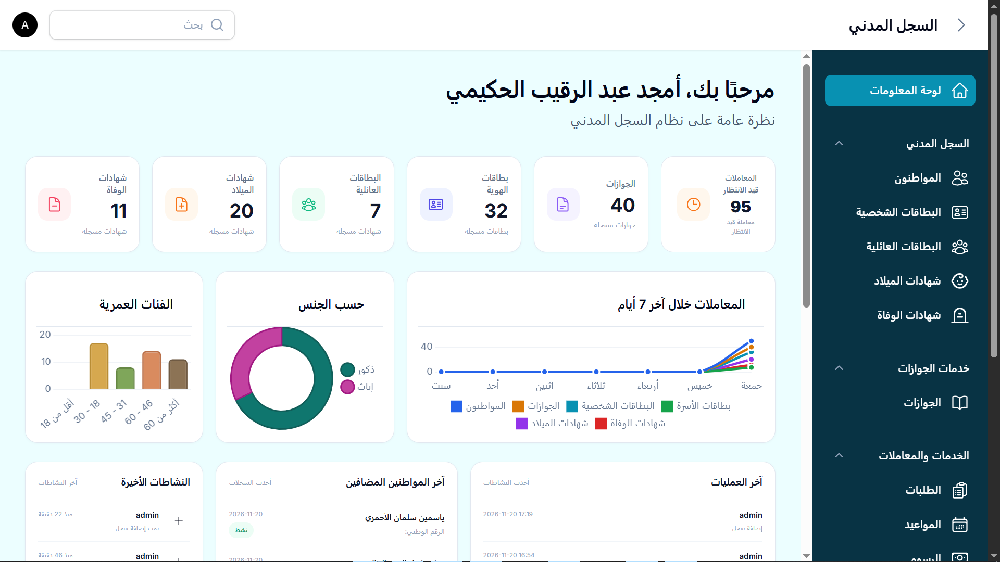
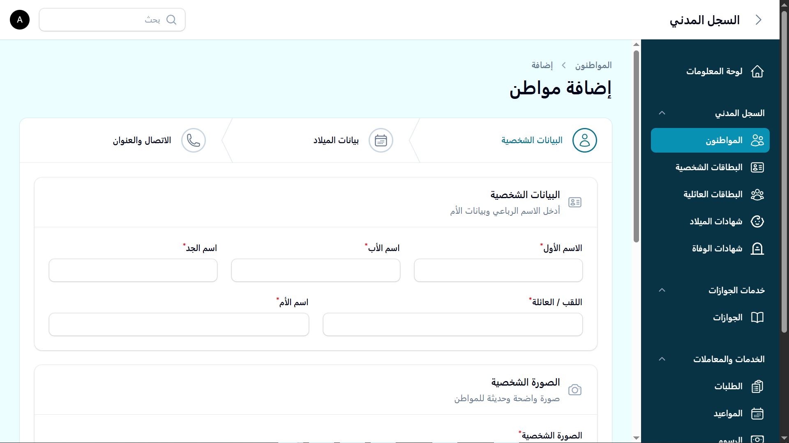
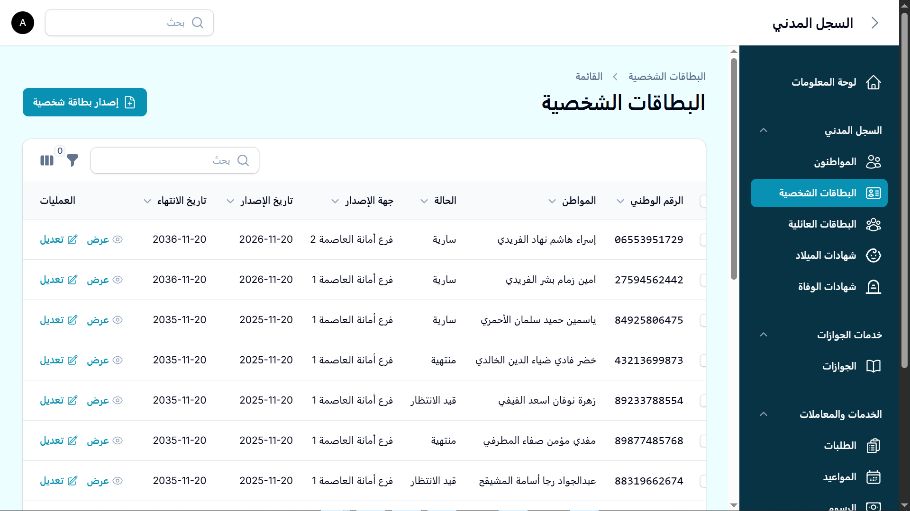
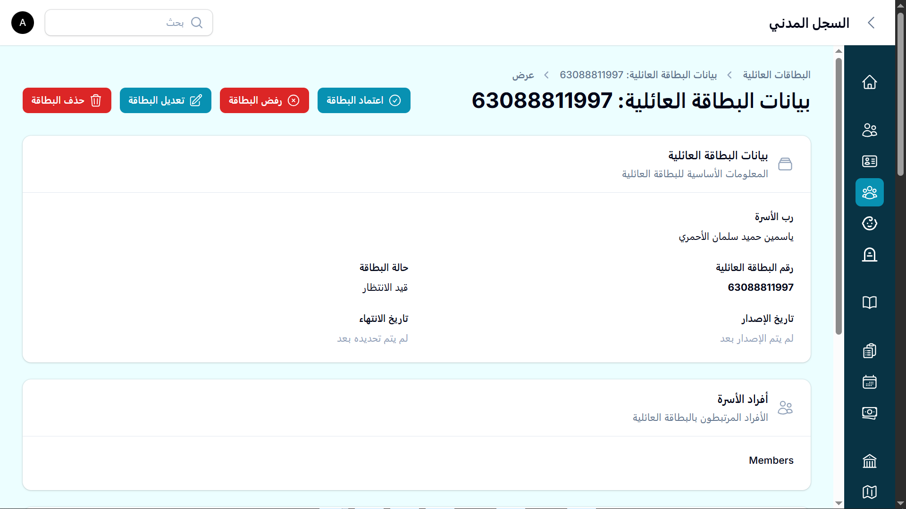
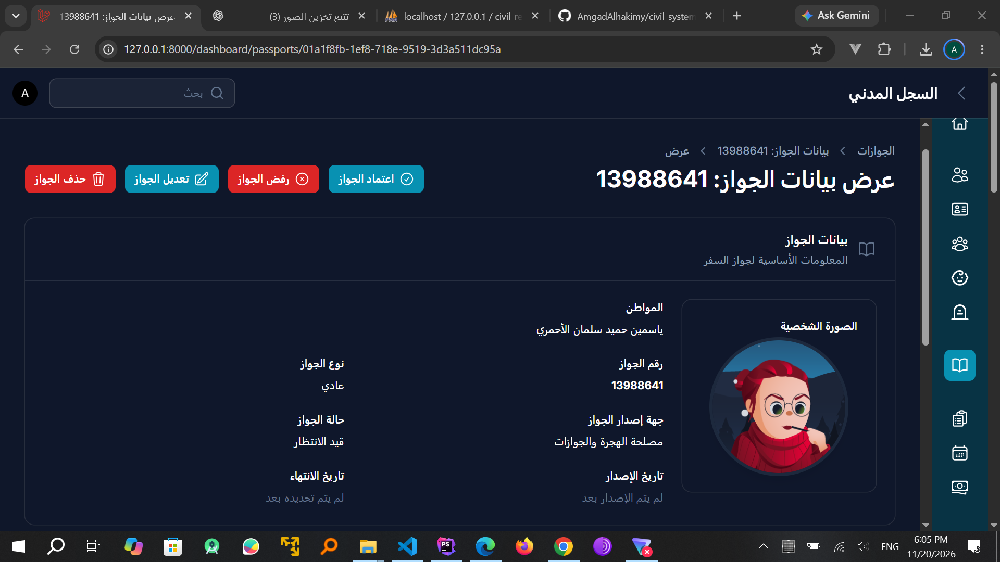
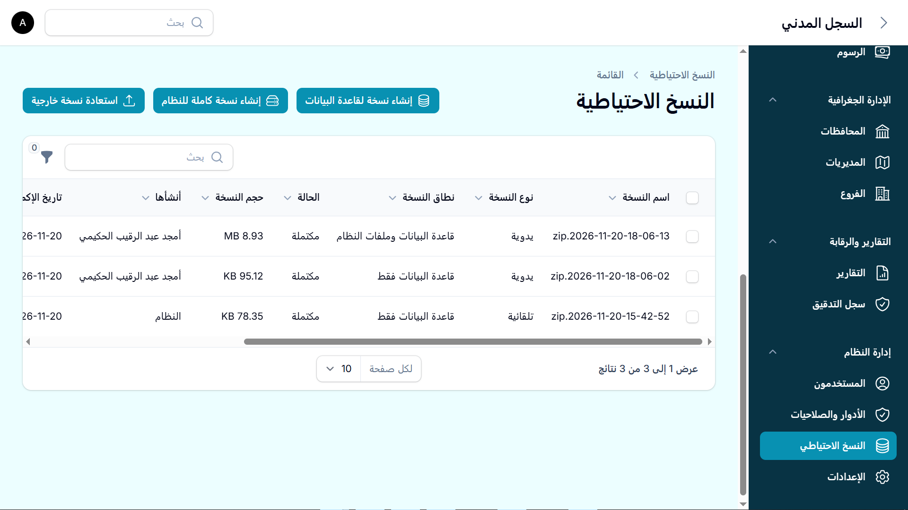
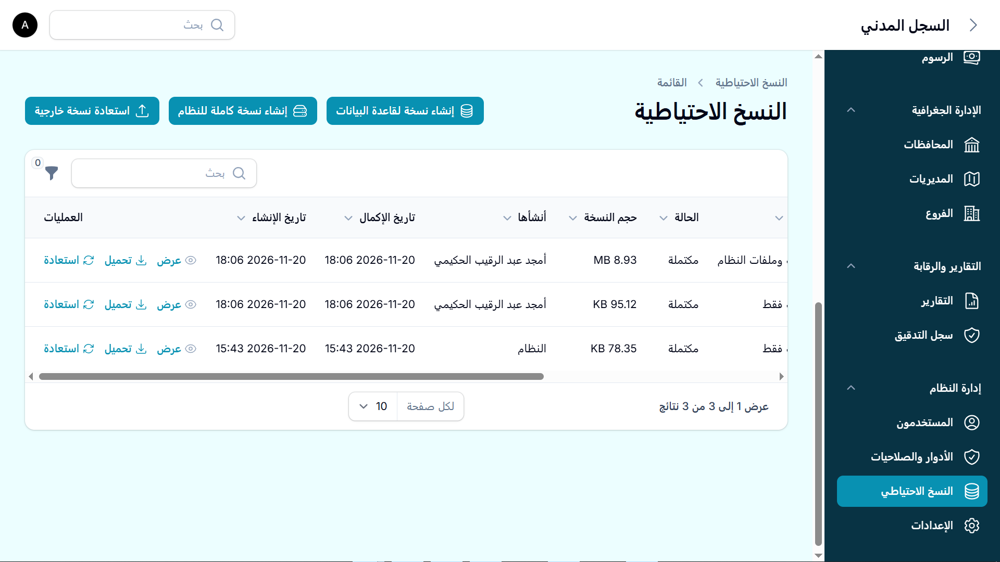
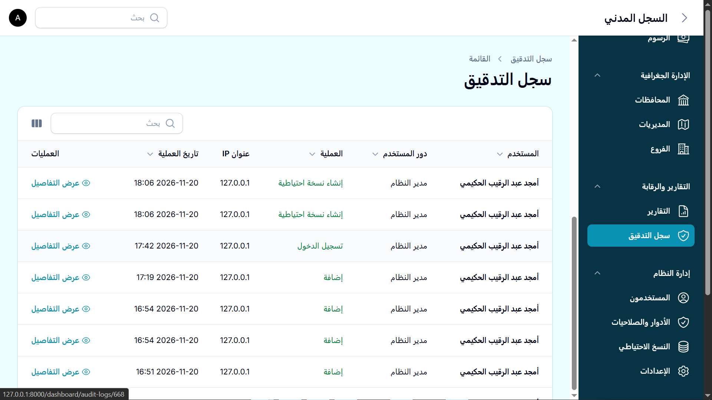

# نظام السجل المدني (Civil System)

> نظام ويب لإدارة بيانات المواطنين ومعاملات ووثائق السجل المدني، مع لوحة
> تحكم عربية لإدارة المستخدمين والصلاحيات ومتابعة العمليات.

------------------------------------------------------------------------

## لقطات من النظام

### لوحة التحكم



### إضافة المواطنين



### عرض البطاقات الشخصية



### عرض البطاقة العائلية 



###  عرض جواز السفر بثيم داكن



### النسخ الاحتياطي





### سجل التدقيق


------------------------------------------------------------------------

## نبذة عن النظام

يهدف نظام السجل المدني إلى تنظيم بيانات المواطنين وإدارة الوثائق المدنية
من خلال تطبيق مركزي. يوفر النظام واجهة إدارية باللغة العربية لإدخال
البيانات ومراجعتها وإدارة الوثائق المرتبطة بالمواطنين، مع تنظيم الوصول
إلى الوظائف بحسب أدوار المستخدمين وصلاحياتهم.

يركز النظام على جمع بيانات المواطنين ووثائقهم في مكان واحد، وتسهيل
متابعة السجلات والعمليات الإدارية بدلاً من الاعتماد على الإجراءات الورقية
المتفرقة.

## الوحدات الرئيسية

### 1. إدارة المواطنين

تُستخدم هذه الوحدة لإدارة السجلات الأساسية للمواطنين، بما في ذلك البيانات
الشخصية والصورة الشخصية، وتكون بيانات المواطن أساساً للوثائق المرتبطة به.

### 2. البطاقات الشخصية

تتيح إدارة سجلات البطاقات الشخصية وربطها بالمواطن، ومتابعة بيانات
البطاقة وحالتها وإجراءاتها. كما يتضمن نموذج البطاقة صور بطاقات الشاهدين،
الأمامية والخلفية.

### 3. البطاقات العائلية

تُستخدم لإدارة بيانات البطاقة العائلية وربطها برب الأسرة وأفراد الأسرة،
مع إمكانية متابعة بيانات البطاقة وأعضائها. ويتضمن نموذجها صور بطاقات
الشاهدين.

### 4. جوازات السفر

تُستخدم لإدارة سجلات جوازات السفر المرتبطة بالمواطنين، مع بيانات الجواز
ونوعه وحالته، وإرفاق صور بطاقات الشاهدين عند الحاجة.

### 5. شهادات الميلاد والوفاة

تضم وحدات لإدارة شهادات الميلاد وشهادات الوفاة وربط كل شهادة ببيانات
المواطن ذات الصلة، مع حفظ بيانات الشهود وصور بطاقاتهم.

> تختلف الحقول والإجراءات المتاحة بحسب نوع الوثيقة وإعدادات النموذج
> والصلاحيات الممنوحة للمستخدم.

## المستخدمون والأدوار والصلاحيات

يوفر النظام إدارة لحسابات المستخدمين والتحكم في الوصول إلى وظائفه من
خلال الأدوار والصلاحيات. ويدعم تصنيف الحسابات إلى موظفين وجهات خاصة، مع
إسناد الصلاحيات بحسب الدور الممنوح للحساب.

تُستخدم الصلاحيات للتحكم في العمليات مثل عرض السجلات وإنشائها وتعديلها
وحذفها واستعادتها، بحسب الوحدة وإعدادات النظام.

## لوحة التحكم والمتابعة

تجمع لوحة التحكم مؤشرات وملخصات عن بيانات النظام والعمليات، وتضم عناصر
متابعة مثل الإحصائيات والعمليات اليومية والأنشطة الحديثة، وفق الودجات
المفعّلة في المشروع.

## سجل العمليات

يسجل النظام الأنشطة المرتبطة بالمستخدمين والعمليات الإدارية، بما يساعد
على مراجعة ما تم تنفيذه ومتابعة سجل النشاط.

## التقارير

يتضمن المشروع آلية لعرض ملفات التقارير من خلال مسار مخصص ومحمي بتسجيل
الدخول. وتخضع إمكانية الوصول إلى التقارير لإعدادات التطبيق وصلاحياته.

## النسخ الاحتياطي والاستعادة

يوفر النظام إدارة للنسخ الاحتياطية، مع دعم نسخ قاعدة البيانات والنسخ
الكاملة التي تشمل الملفات المحددة ضمن إعدادات النسخ. كما تتوفر وظيفة
استعادة النسخ من خلال لوحة التحكم للمستخدمين المخولين.

ينبغي الاحتفاظ بنسخ احتياطية في موقع آمن واختبار الاستعادة بصورة دورية.

## الإعدادات

تتيح صفحة الإعدادات إدارة عدد من تفضيلات النظام، مثل اسم النظام والمنطقة
الزمنية والمظهر وبعض إعدادات النسخ الاحتياطي، وفق الخيارات المتاحة في
نسخة المشروع.

------------------------------------------------------------------------

## البنية التقنية

يعتمد المشروع على التقنيات التالية:

  التقنية                     الاستخدام
  --------------------------- ---------------------------------------------
  PHP                         لغة البرمجة الأساسية
  Laravel 12                  إطار عمل التطبيق
  Filament 4                  بناء لوحة التحكم والموارد والنماذج والجداول
  MySQL / MariaDB             قاعدة البيانات
  Livewire                    التفاعل داخل واجهات Filament
  Vite                        بناء أصول الواجهة الأمامية
  Spatie Laravel Permission   إدارة الأدوار والصلاحيات
  Spatie Activitylog          تسجيل الأنشطة
  Laravel Sanctum             المصادقة عند استخدام واجهات API
  Spatie Laravel Backup       وظائف النسخ الاحتياطي

## متطلبات التشغيل

-   PHP 8.2 أو إصدار متوافق مع اعتماديات المشروع.
-   Composer.
-   MySQL أو MariaDB.
-   Node.js و NPM.
-   خادم محلي مثل XAMPP، أو بيئة تشغيل مناسبة لـ Laravel.

## تثبيت المشروع وتشغيله

### 1. تنزيل الاعتماديات

من داخل مجلد المشروع:

``` bash
composer install
npm install
```

### 2. إعداد ملف البيئة

انسخ ملف البيئة النموذجي:

``` bash
cp .env.example .env
```

في Windows باستخدام Command Prompt:

``` bat
copy .env.example .env
```

أنشئ مفتاح التطبيق:

``` bash
php artisan key:generate
```

### 3. إعداد قاعدة البيانات

أنشئ قاعدة بيانات فارغة، ثم حدّث إعدادات الاتصال في ملف `.env` بما يتناسب
مع بيئتك:

``` env
DB_CONNECTION=mysql
DB_HOST=127.0.0.1
DB_PORT=3306
DB_DATABASE=civil_registry
DB_USERNAME=root
DB_PASSWORD=
```

### 4. تنفيذ الترحيلات

``` bash
php artisan migrate
```

إذا كان المشروع يحتوي على Seeders مطلوبة للأدوار أو الصلاحيات أو
البيانات الأولية، راجع ملفات `database/seeders` ونفّذ الـ Seeder المعتمد
للمشروع.

### 5. بناء ملفات الواجهة

``` bash
npm run build
```

### 6. إعداد رابط التخزين العام

``` bash
php artisan storage:link
```

### 7. تشغيل خادم التطوير

``` bash
php artisan serve
```

ثم افتح:

-   التطبيق: `http://127.0.0.1:8000`
-   لوحة التحكم: `http://127.0.0.1:8000/dashboard`

> قد تختلف إعدادات التشغيل أو خطوات التهيئة بحسب ملف البيئة والاعتماديات
> وإعدادات نسخة المشروع المستخدمة.

## ملاحظات للمطور

-   لا ترفع ملف `.env` أو بيانات الدخول أو مفاتيح التطبيق إلى مستودع
    عام.
-   لا تستخدم `php artisan migrate:fresh` على قاعدة بيانات تحتوي على
    بيانات مهمة؛ فهذا الأمر يحذف الجداول ويعيد إنشائها.
-   تأكد من إعداد الأدوار والصلاحيات وحساب المدير وفق آلية التهيئة
    الموجودة في المشروع.
-   راجع إعدادات الأقراص ومسارات التخزين قبل نقل التطبيق إلى بيئة إنتاج.
-   اختبر النسخ الاحتياطي والاستعادة قبل الاعتماد على النسخ في بيئة
    العمل.
-   لا تضع صوراً أو بيانات حقيقية للمواطنين في مستودع Git أو في لقطات
    README المنشورة.

## هيكل المجلدات ذات الصلة

``` text
CivilSystem/
├── app/
│   ├── Filament/       # موارد وصفحات ولوحة تحكم Filament
│   ├── Models/         # نماذج قاعدة البيانات
│   └── ...
├── database/
│   ├── migrations/     # ترحيلات قاعدة البيانات
│   └── seeders/        # البيانات الأولية
├── docs/
│   └── images/         # لقطات شاشة README
├── public/             # الملفات العامة وأصول الواجهة
├── resources/          # ملفات الواجهة والترجمات
├── routes/             # مسارات التطبيق
├── storage/            # الملفات والسجلات والملفات المؤقتة
├── .env.example
└── README.md
```

------------------------------------------------------------------------

## حقوق المشروع

**اسم المشروع:** نظام السجل المدني (Civil System)

تُستكمل بيانات الجهة المطورة أو الجامعة أو فريق العمل هنا عند تجهيز نسخة
التسليم.
